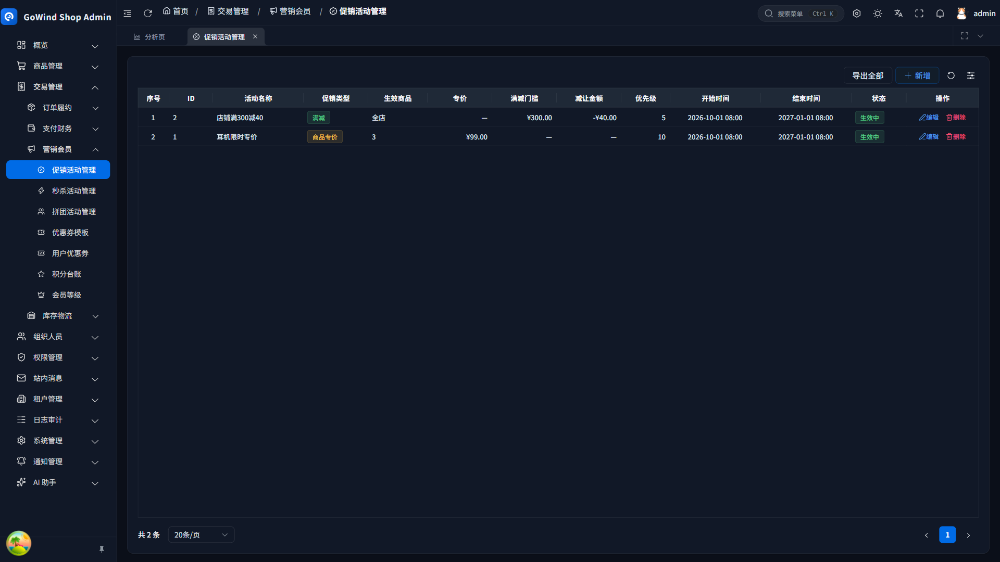
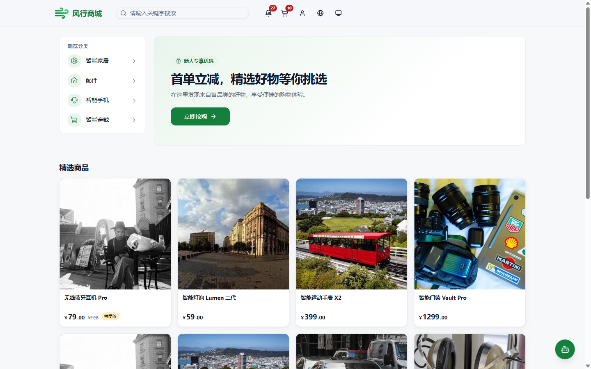
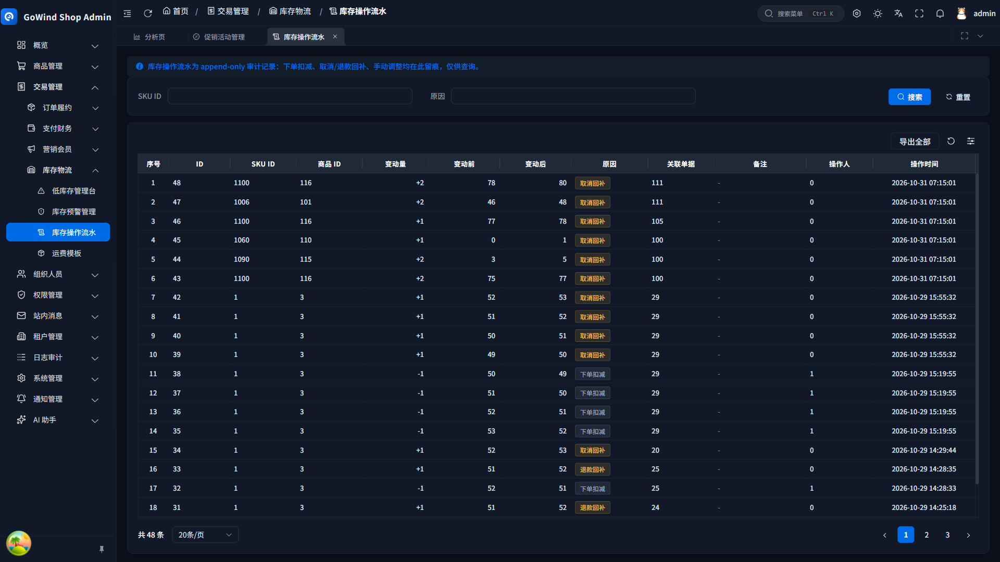
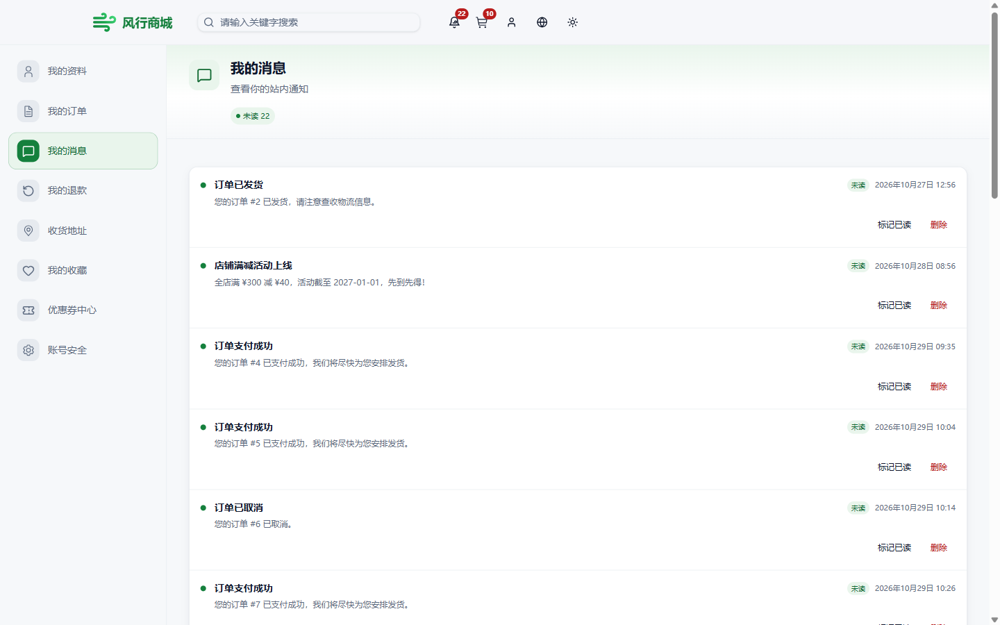
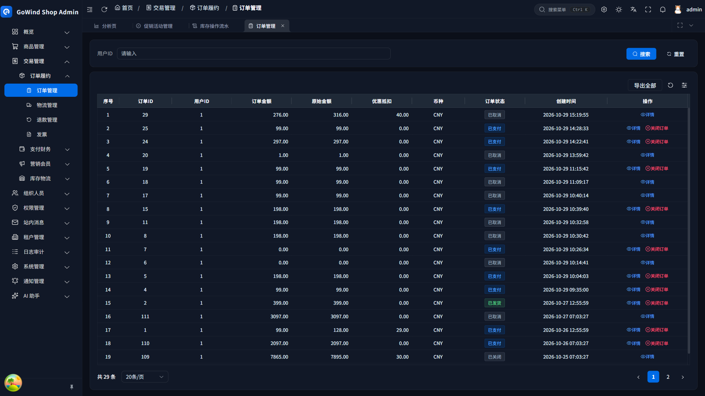
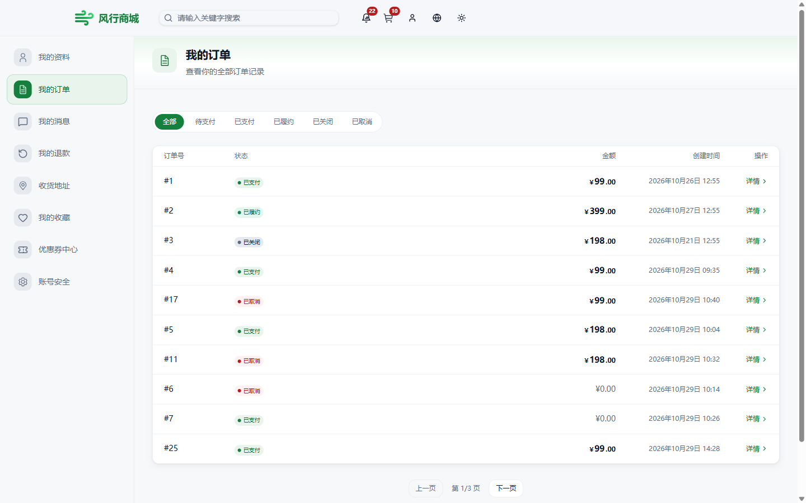
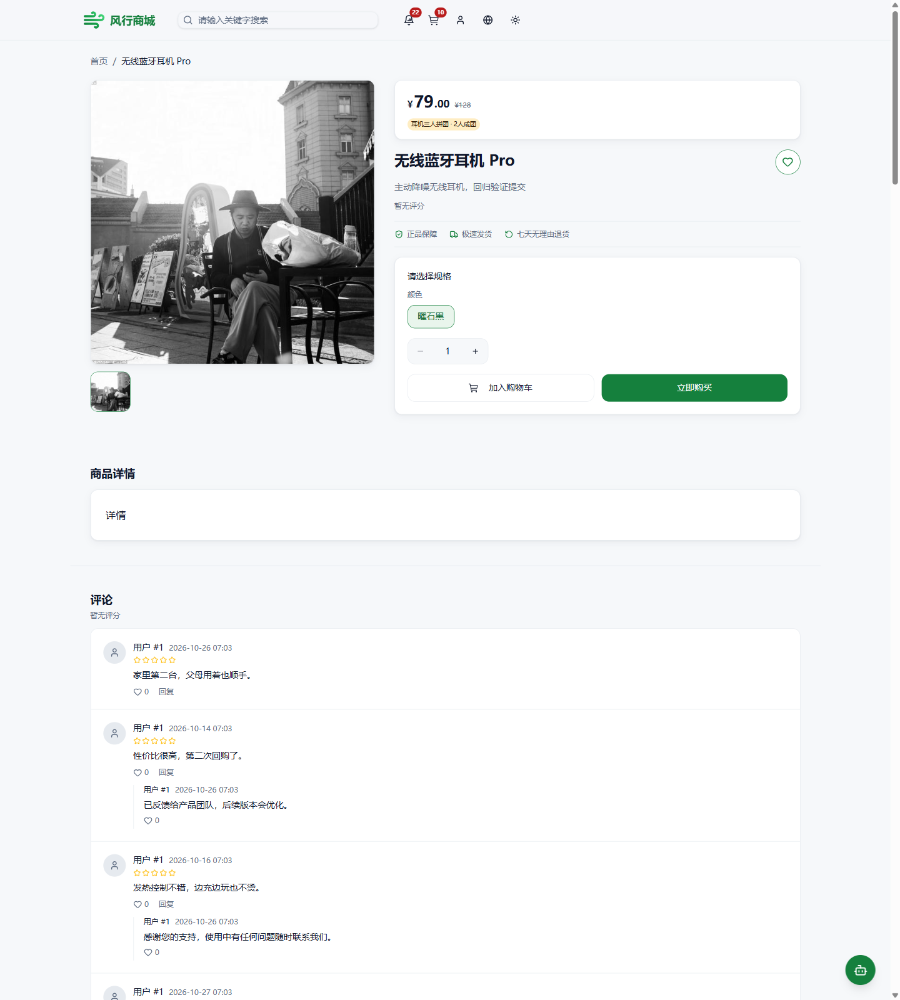
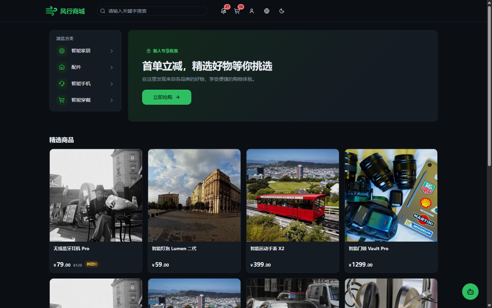

<div align="center">


# GoWind Shop｜風行ショップ

[](https://go.dev/)
[](https://vuejs.org/)
[](https://www.docker.com/)

[English](./README.en-US.md) | [中文](./README.md) | **日本語**

</div>

---

## プロジェクト概要

GoWind Shop（風行ショップ）は、越境シナリオ向けのエンタープライズ級多言語ECプラットフォームです。APIファースト・フロントエンド/バックエンド分離アーキテクチャを採用し、ネイティブな多言語コンテンツ配信、多通貨の商品表示、単一決済通貨の機能を提供します。バックエンドは [golang](https://go.dev/) + [go-kratos](https://go-kratos.dev/) マイクロサービスフレームワークを基盤とし、Protobufファースト（契約駆動）のワークフローを採用。管理画面フロントエンドは [Vue.js 3](https://vuejs.org/) + [TypeScript](https://www.typescriptlang.org/)、店舗フロントエンドは [Nuxt](https://nuxt.com/) + Vue 3 で構築しています。

## 特徴

- **多言語ネイティブサポート**：i18n に基づく多言語コンテンツ配信、越境シナリオ向け設計。
- **契約駆動（Protobufファースト）**：インターフェース・データモデル・エラーコードは proto を唯一の真実の情報源とし、Go / TypeScript / OpenAPI を自動生成。
- **3サービスBFFアーキテクチャ**：`admin` / `app` の薄いゲートウェイと `core` のコア実装により、ビジネスロジックとトランスポート層を分離。
- **フルスタックコード生成**：Ent スキーマ → ORM、ワンクリック CRUD スキャフォールド。
- **店舗フロント全面リニューアル**：20 ページを統一デザインシステムで再構築、ライト/ダーク両テーマ、モバイル吸着ナビゲーション対応。
- **本番対応**：JWT 認証、Casbin / OPA 認可、SSE プッシュ、Asynq 非同期タスク、OpenTelemetry トレーシング、Swagger ドキュメント、Docker ワンクリックデプロイ。

---

## システムアーキテクチャ

GoWind Shop は 3 サービスの BFF アーキテクチャを採用します。`admin` と `app` は薄いゲートウェイであり、パラメータ検証と gRPC 転送のみを行います。`core` はコア実装であり、すべてのデータアクセスはここに集約されます。

```
HTTP/REST リクエスト
  └─ admin-service  (管理画面ゲートウェイ BFF、REST:10600 / SSE:10601 / gRPC)
       └─ gRPC → core-service  (コア業務 + データ永続化)

app-service (店舗ゲートウェイ BFF、REST:10700) ──gRPC──→ core-service
core-service (gRPC、業務実装とデータアクセス)
```

| サービス | 役割 | DB アクセス |
|------|------|:---:|
| `app/admin/service` | 管理画面ゲートウェイ BFF（REST を受信し core へ gRPC 転送） | ❌ |
| `app/app/service` | 店舗ゲートウェイ BFF | ❌ |
| `app/core/service` | コア業務実装（永続化、実ロジック） | ✅ |

---

## 技術スタック

<table>
<tr><th>階層</th><th>技術</th></tr>
<tr><td><strong>バックエンドフレームワーク</strong></td><td><code>Golang</code> · <code>go-kratos v2</code> · <code>Protobuf / Buf</code></td></tr>
<tr><td><strong>ORM</strong></td><td><code>entgo.io/ent</code> · <code>PostgreSQL</code> · <code>MySQL</code></td></tr>
<tr><td><strong>ミドルウェア</strong></td><td><code>Redis</code> · <code>MinIO</code>（S3 互換オブジェクトストレージ） · <code>ElasticSearch / OpenSearch</code> · <code>etcd</code>（サービスディスカバリ）</td></tr>
<tr><td><strong>認証・認可</strong></td><td><code>kratos-authn</code>（JWT HS256） · <code>kratos-authz</code>（Casbin / OPA）</td></tr>
<tr><td><strong>リアルタイム通信</strong></td><td><code>SSE</code>（サーバープッシュ） · <code>Asynq</code>（非同期タスク）</td></tr>
<tr><td><strong>分散</strong></td><td><code>OpenTelemetry + Jaeger</code>（トレーシング） · <code>DTM</code>（分散トランザクション）</td></tr>
<tr><td><strong>管理画面フロントエンド</strong></td><td><code>Vue 3</code> · <code>TypeScript</code> · <code>Vite</code> · <code>Element Plus</code></td></tr>
<tr><td><strong>店舗フロントエンド</strong></td><td><code>Nuxt</code> · <code>Vue 3</code> · <code>TypeScript</code> · <code>Tailwind CSS</code> · <code>i18n</code></td></tr>
<tr><td><strong>デプロイ・運用</strong></td><td><code>Docker</code> · <code>Docker Compose</code> · <code>PM2</code> · <code>Swagger UI</code></td></tr>
</table>

---

## クイックスタート

### 環境要件

| ツール | バージョン |
|------|------|
| Go | 1.25+ |
| Node.js | >= 20.10.0 |
| pnpm | >= 10.0.0 |
| Docker | 20.0+ |

### 環境スクリプト選択

- Linux / macOS 開発環境：`scripts/env/install_unix_dev.sh`
- Linux / macOS 本番環境：`scripts/env/install_unix_prod.sh`
- Windows 開発環境：`scripts/env/install_windows_dev.ps1`

### Docker 2つのデプロイモード

- **full_deploy 完全モード**：ミドルウェア+バックエンドアプリを同時起動、ワンクリックデモ・本番デプロイに適用。
- **libs_only 依存モード（推奨）**：ミドルウェアのみ起動、アプリはローカルIDEで実行・デバッグ、日常開発に適用。

### バックエンド起動

**Linux / macOS：**

```shell
# スクリプトに実行権限を付与
chmod +x scripts/**/*.sh

# 開発環境（推奨）
./scripts/env/install_unix_dev.sh
./scripts/docker/libs_only.sh
cd backend/app/<admin|app|core>/service
make run

# 本番環境
./scripts/env/install_unix_prod.sh
./scripts/docker/full_deploy.sh

# PM2 プロセス管理（本番上級）
./scripts/deploy/pm2_service.sh
```

**Windows（PowerShell 管理者）：**

```powershell
# スクリプト実行ポリシーの許可（初回のみ1回実行）
Set-ExecutionPolicy RemoteSigned -Scope CurrentUser

# 環境初期化
.\scripts\env\install_windows_dev.ps1

# ローカル開発
.\scripts\docker\libs_only.ps1
cd backend/app/<admin|app|core>/service
make run

# ワンクリック完全デプロイ
.\scripts\docker\full_deploy.ps1
```

### フロントエンド起動

フロントエンドプロジェクトは `frontend` ディレクトリに統一して配置されています。依存関係のインストールコマンドは共通です：

| フロントエンド | ディレクトリ | 起動コマンド |
|----------|-----------|---------|
| 管理画面 | `frontend/admin` | `pnpm dev` |
| 店舗フロント | `frontend/app` | `pnpm dev` |

```shell
# 依存関係のインストール
pnpm install

# 管理画面（Vue3 + Element Plus）
cd frontend/admin && pnpm dev

# 店舗フロント（Nuxt + Vue 3）
cd frontend/app && pnpm dev
```

> リッスンポートは各フロントエンドの `.env.development` で設定されます。

---

## 機能リスト

### スクリーンショット

| 管理コンソール | 店舗フロント |
|:---:|:---:|
|  |  |
| **プロモーション管理**（商品特価 / 満額減額） | **店舗ホーム**（未読バッジ · AI ショッピングアシスタント） |
|  |  |
| **在庫操作ログ**（append-only 監査） | **メッセージセンター**（注文通知 · 未読マーク） |
|  |  |
| **注文管理**（状態機械 + キャンセル/クローズ） | **マイ注文**（ライフサイクル全体の状態） |
|  |  |
| **商品詳細**（グループ価格の取り消し線 · プロモバッジ · レビュー） | **店舗ホーム · ダークテーマ**（ワンクリック切替） |

### コマース

| 機能 | 説明 |
|------|-----|
| 商品管理 | 商品と SKU の公開・公開停止・公開解除、および保守。 |
| 商品属性 | 商品属性および属性値の管理。 |
| カテゴリ管理 | 商品カテゴリの管理、ツリー構造をサポート。 |
| ブランド管理 | ブランド情報の管理。 |
| SKU と価格設定 | SKU、属性の組み合わせ、価格の管理。 |
| ショッピングカート | カートおよびカート項目の管理。 |
| 注文管理 | 注文および注文明細の管理。楽観的並行制御による注文状態機械を含む。 |
| 注文自動化 | 期限超過の未払い注文の自動キャンセル（遅延タスク + 定期スイープ）、出荷後の自動受領確認。 |
| 注文通知 | 決済・出荷・キャンセル・受領確認・返金のライフサイクル全般にわたるアプリ内通知。 |
| 検索 | OpenSearch 全文検索 + 入力候補（商品名の前方フレーズマッチ）+ AI クエリリライト（自然言語 → 検索キーワード群）。ReindexAll による周期全量再インデックスで双方向収束。 |
| プロモーション | 商品特価・店舗満額減額・秒殺（フラッシュセール）・グループ購入——チェックアウトトランザクション内で統一計価、優先度は グループ購入 > 秒殺 > 特価、クーポンとの併用は下限 0 円で封止。 |
| 在庫操作ログ | append-only 監査：注文控除、キャンセル/返金の復元、手動調整をすべて記録。 |
| 秒殺（フラッシュセール） | SKU 単位の期間限定・数量限定販売。秒殺価格が最優先で決済価格を上書き、行ロックで過剰販売を防止、一人あたり購入制限付き。 |
| グループ購入（Groupon） | グループ価格での購入（`group_size` 人の支払いで結成）。期限切れの未結成グループは `groupon_sweep` 定期タスクでメンバー注文を自動返金・クローズ。 |
| 会員ポイント | 購入時のポイント付与（1 ポイント/元、ランク倍率で増幅）+ 返金時の取消 + 毎日チェックイン（+5/日、冪等）+ ポイントからクーポンへの交換。append-only 台帳 + 残高スナップショット。 |
| 会員ランク | 累計支払額による自動階層化（レベル降順でマッチング）。ポイント付与はランク倍率で増幅。 |
| 返品・返金（アフターサービス） | 購入者が申請 → 管理画面で承認 → 決済ゲートウェイ経由の返金（WeChat/Alipay API）+ 取引 REFUNDED + 在庫復元 + アプリ内通知 + ポイント取消。 |
| 消し込み自動修復 | 古くなった PENDING 取引を定期スキャンし、能動的にゲートウェイへ照会——コールバック喪失分の入金を確認して注文を推進、ゲートウェイ側クローズ済みは FAILED に収束。返金ドリフト検知アラート付き。 |
| 注文クローズ連携 | 注文キャンセル/タイムアウト後にベストエフォートでゲートウェイの事前支払い注文をクローズし、古い QR コード/レジリンクを無効化。 |
| 商品レビュー | ツリー構造レビュー、いいね、商家返信、オプションの AI アンチスパム。 |
| AI ショッピングアシスタント | Function Call ツールループ（商品検索・価格確認・注文/クーポン照会）とフロントのフローティングアシスタント。 |
| 決済と返金 | WeChat Native/H5・Alipay・Mock の 3 決済チャネルアダプタ。インテント/コールバック二段階方式、消し込み自動修復、返金ドリフト検知、注文クローズ連携、返金自動化（ゲートウェイ返金 → 在庫復元 → アプリ内通知 → ポイント取消）。加盟店が自己の加盟店資格を持ち込み、プラットフォームは資金を介さない。 |
| 物流・出荷 | 注文履行と出荷管理。出荷状態機械と注文状態連携を含む。 |
| クーポンシステム | クーポンテンプレートとユーザークーポンの管理。決済時の割引エンジン、チェックアウトでの適用・返金時の復元を含む。 |
| 財務エクスポート | 消し込み用の注文明細サーバーサイド XLSX エクスポート。 |
| ファイル転送 | 商品画像やリソースのアップロード・転送。 |

### プラットフォーム・システム

| 機能 | 説明 |
|------|-----|
| ユーザープロファイル | ユーザープロファイル情報の管理。 |
| テナント管理 | マルチテナントの管理と初期化。 |
| ロール管理 | ロールおよびロールグループの管理。 |
| 権限管理 | 権限グループと権限ポイントの管理。 |
| メニュー管理 | システムメニューとボタン権限の設定。 |
| 組織管理 | 組織・部署・役職の管理。 |
| インターフェース管理 | インターフェースの登録と同期。 |
| ディクショナリと多言語 | データディクショナリと多言語コンテンツの管理。 |
| タスクスケジューリング | 非同期タスクとスケジューリングログの管理。 |
| ファイル管理 | ファイルアップロードとオブジェクトストレージの管理。 |
| 内部メッセージ | サイト内メッセージとメッセージ分類の管理。 |
| 監査ログ | ログイン・操作・権限・データアクセスの監査ログ。 |
| パスワード再設定 | メール認証コードによるパスワード再設定フロー。 |
| ログインポリシー | ログインポリシーの設定と管理。 |

---

## プロジェクト構造

```
go-wind-shop/
├── backend/                        # バックエンドプロジェクト
│   ├── api/                        # Protobuf API 定義と生成コード
│   │   ├── protos/                 # .proto ソースファイル（ドメイン別階層）
│   │   └── gen/go/                 # buf 生成 Go コード
│   ├── app/                        # アプリケーション層（admin / app / core の3マイクロサービス）
│   │   └── <admin|app|core>/service/
│   │       ├── cmd/server/         # エントリポイント + 手書きアセンブリ
│   │       ├── configs/            # 実行時設定（YAML）
│   │       └── internal/           # 業務コア（server / service / data）
│   ├── pkg/                        # サービス間共通ライブラリ
│   ├── scripts/                    # デプロイ・環境スクリプト（env / docker / deploy）
│   ├── sql/                        # データベースシード / デモデータスクリプト
│   └── Makefile / app.mk           # ビルドオーケストレーション
├── frontend/                       # フロントエンドプロジェクト
│   ├── admin/                      # Vue 3 + Element Plus 管理画面
│   └── app/                        # Nuxt + Vue 3 店舗フロント
└── README.md
```

---

## お問い合わせ

- WeChat 個人アカウント：`yang_lin_bo`（備考：`go-wind-shop`）
